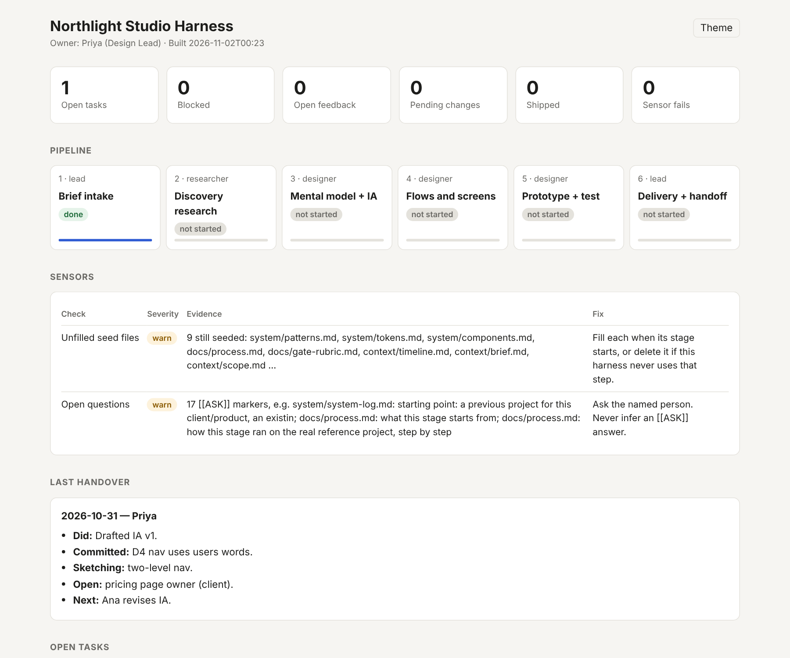

<p align="center">
  
</p>

<p align="center">
  <a href="https://github.com/blisse-code/harness-atelier/actions/workflows/evals.yml"></a>
  
  
</p>

**Harness Atelier is a Claude skill that builds the harness around the AI for a designer or design team.** It interviews you about one real project, shows you a one-page map of the harness for sign-off, then generates and tests a working system: a short instruction map, workflow skills, an independent reviewer agent, hooks, structured records, deterministic checks, a confidentiality guard and a status dashboard. It works for agencies and studios, solo freelancers and in-house product teams.

If any of these sound familiar, this is for you:

- *"It was great yesterday and forgot everything today."*
- *"It keeps inventing spacing values."*
- *"The client's feedback got lost between the meeting and the Figma file."*

Those aren't model problems. They're harness problems: nothing tells the AI what to read first, where the truth lives, what it must stay inside, or how its work gets checked before a person sees it.

---

## Install

**Claude Code (plugin marketplace)**

```text
/plugin marketplace add blisse-code/harness-atelier
/plugin install harness-atelier@harness-atelier
```

**Claude app (web or desktop)**

Download `harness-atelier.skill` from the [latest release](https://github.com/blisse-code/harness-atelier/releases/latest) and add it as a skill in Claude's settings. Building a harness runs Python scripts, so it needs a Claude environment with code execution.

**Manual**

Copy `skills/harness-atelier/` into `~/.claude/skills/` (personal) or `.claude/skills/` in a project.

Requirements: Python 3.8 or newer. No packages to install: every script uses the standard library.

## Use it

Say what you need in your own words. For example:

> I lead a small design team at an agency. Set up Claude so every project follows our process: brief, research, design, client sign-off.

> I'm a freelance product designer. Claude keeps losing context between sessions. Build me a proper harness.

> Use our old project folder as a read-only reference and build a harness for our in-house design team.

The skill takes several turns. It asks one question at a time and recommends an answer each time. Before it writes any files, it stops to show you the map.

## How it works

<p align="center">
  
</p>

| Phase | What happens | Why |
|---|---|---|
| **0 · Look** | Takes stock of what you already have: instruction files, skills, your design system, any reference repos (read-only). | Merging with what exists beats building something parallel to it. |
| **1 · Interview** | Walks through one real project start to finish, then one that went badly. | People describe their ideal process in the abstract. The harness has to fit the real one. |
| **2 · Map** | One page showing each stage with its owner, its output, what steers it and what checks it, plus the fix for every past failure. | Structure before files. This is the cheapest point to correct it. |
| **3 · Generate** | `scaffold.py` writes the full system. It never overwrites a file and refuses to write into protected folders. | Your existing work stays safe. |
| **4 · Tailor** | Fills in your stage methods, logs each rule with who decided it, and turns each known failure into a real check. | "Be more careful" is not a fix. |
| **5 · Verify** | `verify_harness.py` runs the sensors, plants a fake confidential term to prove the guard blocks it, checks the hooks and builds the dashboard. Then a dry run on a realistic brief. | The skill only says it works after it has run it. |
| **6 · Hand over** | What was built, how to start, open questions grouped by who can answer them, and a time-boxed first week. | You leave with a plan, not a pile of files. |

## What it builds

| Part | Job | In the generated harness |
|---|---|---|
| **Rails** | What output must stay inside | `system/` (tokens, components with "must never become" rules, patterns), `context/ux-context.md`, a write-time confidentiality guard |
| **Memory** | Where the truth lives between sessions and people | `CLAUDE.md` (a short map, not a manual), `context/`, `docs/decisions.md`, `records/handovers.md` |
| **Moves** | The workflow | Your stages, 8 workflow skills (`intake`, `gate`, `feedback-to-changes`, `system-update`, `synthesise`, `next-steps`, `handoff`, `handover`), an `evaluator` agent, plus a `reconciler` agent for teams who work in parallel |
| **Checks** | Catch problems before a person reviews | `scripts/harness_check.py` (deterministic sensors), then the `gate` skill run by a separate evaluator |
| **Loop** | Turn every miss into a permanent fix | `docs/evolution.md` (failure register, weekly and monthly rituals), the decisions log, a past-work index |

<details>
<summary>Generated folder tree</summary>

```
<your-harness>/
├── CLAUDE.md · AGENTS.md · README.md · harness.config.json
├── docs/        process · decisions · evolution · gate-rubric · onboarding
├── context/     brief · scope · timeline · ux-context
├── system/      tokens · components · patterns · system-log        (design work)
├── records/     tasks · feedback · changes · approvals · ships · gate-log · insights · past-work · handovers
├── work/        research/ · design/ · prototypes/
├── dashboard/   index.html (opens from disk, no server)
├── scripts/     records · harness_check · build_dashboard · install_git_hooks
├── .harness/    schema.json · confidential.txt · confidential.local.txt (gitignored)
└── .claude/     settings.json (hooks) · hooks/ · skills/ · agents/
```
</details>

### Checks: cheapest gate first

<p align="center">
  
</p>

The sensors catch anything a script can find before an AI reviewer spends judgement on it:

- leaked confidential terms;
- unfilled placeholders;
- renamed record columns;
- duplicate IDs;
- feedback that no task picks up;
- a delivery logged without final sign-off;
- an insight with no source;
- colour and spacing values that aren't in your system.

The evaluator is a different agent from the one that made the work, because makers grade their own work kindly. Every finding names its check, cites its evidence and carries a severity: **fail** blocks review, **warn** does not. Only the owner can waive a fail, and the waiver is logged.

### The learning loop

<p align="center">
  
</p>

### A glance at the dashboard

The generated dashboard is one HTML file that opens from disk. It reads only what's already in your records. Motion is subtle (sections fade in, numbers count up, stage bars fill) and switches off completely when the viewer has reduced motion turned on.

<p align="center">
  
</p>

## Fitted to how you work

| Context | What it emphasises |
|---|---|
| **Agency / studio** | Rails per client (never one design system for the whole studio), the client approval gate, who owns the edges of scope, feedback that arrives out of order, several people in one repo |
| **Solo / freelance** | The independent evaluator (you're your own reviewer), handovers to your future self, one master harness copied per client, other clients' names kept on your machine only, about an hour a week of upkeep |
| **In-house product** | A design system shared with engineering (code can be the source of truth), decisions that outlive projects, engineering handoff specs, evidence after launch |

## Promises the skill keeps

- **Reference folders stay read-only.** It reads them and never writes to them; the scaffold refuses `--protect` paths.
- **It never overwrites your files.** Overlaps are shown to you, and you choose what stays.
- **It never guesses.** Anything you didn't answer becomes a visible `[[ASK: …]]` marker.
- **It never creates or asks for secrets, passwords or rates.**
- **It only claims what it ran.** The handover says what was tested and what wasn't.

## Testing

```bash
python3 evals/run_evals.py      # 64 deterministic checks across 4 fixture harnesses
python3 tools/package_skill.py  # builds dist/harness-atelier.skill
```

The evals generate a harness from each fixture (agency, solo master, in-house research, minimal). They plant problems in each one and confirm the right sensor fires. They also check the scaffold's safety promises and that the README visuals are rebuilt from source. CI runs them on Python 3.9 and 3.12. The behavioural rubric, which needs a model and a person, is in [`docs/EVALS.md`](docs/EVALS.md).

## What it doesn't do

- It can't run hooks before you accept Claude Code's trust prompt for the folder. That's a deliberate security boundary.
- It doesn't connect your tools for you. Skills stop and say so when Figma, Drive or Notion isn't connected, rather than faking the step.
- A freshly built harness is a *prototype*. Seeded files and open questions only fill in through real use. The weekly 20-minute check is what keeps it honest.
- Its design checks cover tokens, structure and evidence. Taste, coherence and whether the work is right for the user still need people. The skill sends fewer problems their way; it doesn't replace them.

## How this repo is organised

```
.claude-plugin/marketplace.json   install as a Claude Code plugin
skills/harness-atelier/           the skill: SKILL.md, scripts/, assets/harness-template/, references/
docs/how-it-works.md              the thinking behind each part
docs/EVALS.md                     behavioural rubric and fixture notes
docs/visuals/                     animated SVGs and their generator (build_visuals.py)
evals/                            fixtures and the deterministic eval runner
tools/package_skill.py            builds the .skill file attached to each release
```

The README diagrams are build products. To change one, edit `docs/visuals/build_visuals.py`, run it, and commit both. The motion is CSS only, loops slowly, and freezes into a complete, readable picture when reduced motion is on.

## Credits

The skill's principles were learned from these sources and rewritten in its own words. No source's files or wording were copied.

- Anthropic: harness design for long-running apps (separate generator and evaluator; explicit design criteria)
- Madhuri Maram: [harness map](https://madhurimaram.com/harness), the MIT-licensed [`diy-harness`](https://github.com/iruhdam1/skills/tree/main/skills/diy-harness) and [prefix-first design](https://github.com/iruhdam1/prefix-first-design) (audit before building, stable briefs, evidence-cited checks). This repo's layout was also informed by `diy-harness`: a skill folder, a human-facing guide, an evals rubric and visuals.
- [design-harness.com](https://design-harness.com/en/) and Kogiso's "What is a Design Harness?" (constraints, context, validation, evaluation)
- Alex Merced (dev.to), LangChain and Vercel Academy on building agent harnesses (tools, context, permissions, verification)
- Claire Vo, *How I AI*: building a narrow harness for one recurring workflow
- Böckeler and Lopopolo on harness engineering (guides vs sensors; a map, not an encyclopedia)
- Lessons from running a real studio harness on live projects

## License

MIT. See [LICENSE](LICENSE).
